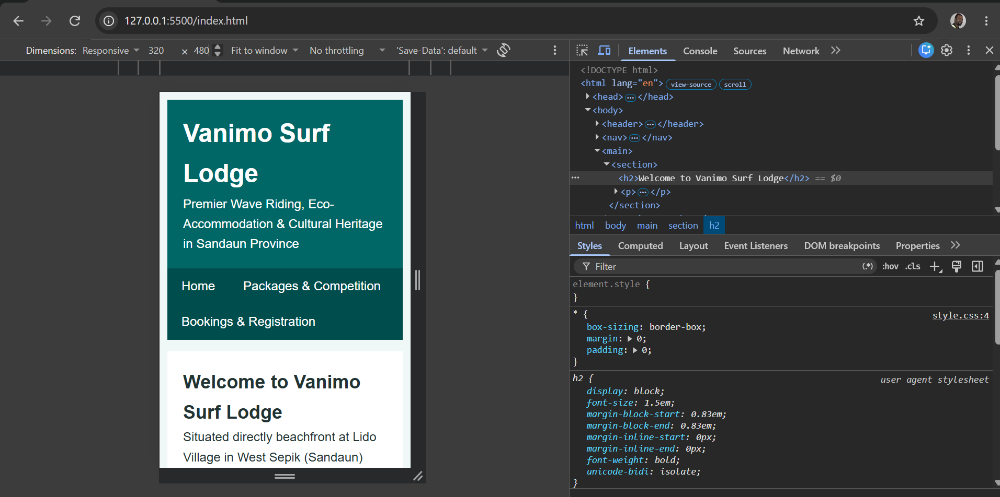
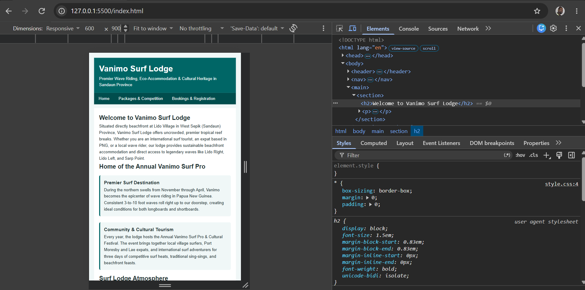
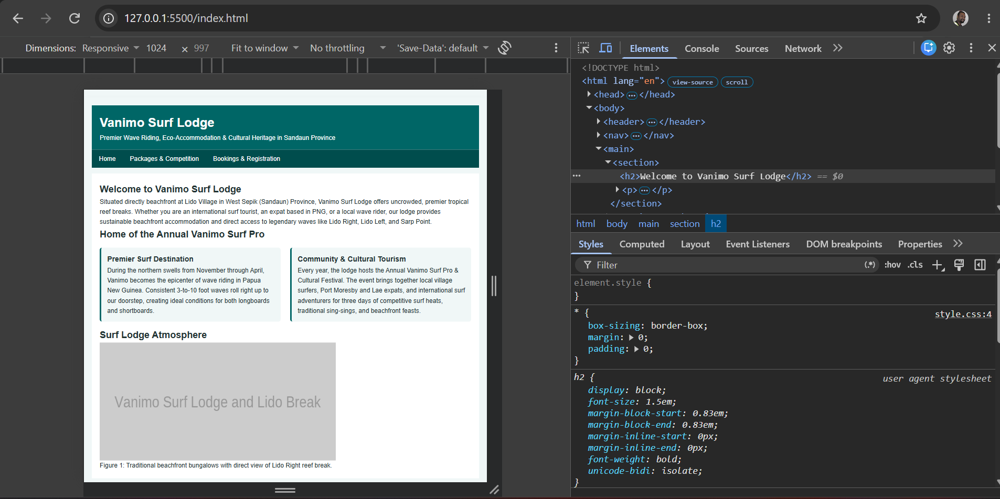

# ISO229 Assessment 3 - Responsive HTML5 + CSS3 Website
**Course:** ISO229 Web Design  
**Assessment:** Assessment 3 - Responsive HTML5 + CSS3 Website (10%)  
**Topic:** Vanimo Surf Lodge & Annual Surf Competition Website  

## 1. Project Purpose & Target Audience
- **Purpose:** To extend the Vanimo Surf Lodge website into a professionally styled, responsive web solution utilizing pure CSS3.
- **Target Audience:** Local PNG surfers, PNG-based expatriates, and international surf tourists accessing the site across mobile, tablet, and desktop viewports.

## 2. Assessment 3 Technical Implementation
- **CSS Architecture:** External stylesheet (`style.css`) built using CSS variables, consistent color systems, typography scale, and a box-sizing reset.
- **Flexbox Layout:** Implemented on the `<nav> ul` navigation container for flexible wrapping and item alignment.
- **CSS Grid Layout:** Implemented via `.card-grid` to manage multi-column card displays across feature sections.
- **Responsive Web Design:** Built using media queries (`min-width: 600px` and `min-width: 1024px`) and fluid scaling (`max-width: 100%`) for images.
- **Accessibility:** Integrated explicit visual `:focus` states across all interactive elements (links, buttons, form inputs).

## 3. Testing Evidence & Viewport Screenshots
- **Mobile Viewport:** 
- **Tablet Viewport:** 
- **Desktop Viewport:** 

## 4. Deployment Information
- **Live Published URL:** https://lwpwaho-dev.github.io/iso229-assessment2/
- **GitHub Repository:** https://github.com/lwpwaho-dev/iso229-assessment2

## 5. AI Use Declaration
**AI Used:** Generative AI was used solely as a technical verification tool to confirm that the HTML5 document structure, semantic tags, form elements, CSS Grid syntax and media query breakpoints were correctly implemented according to standard web practices.